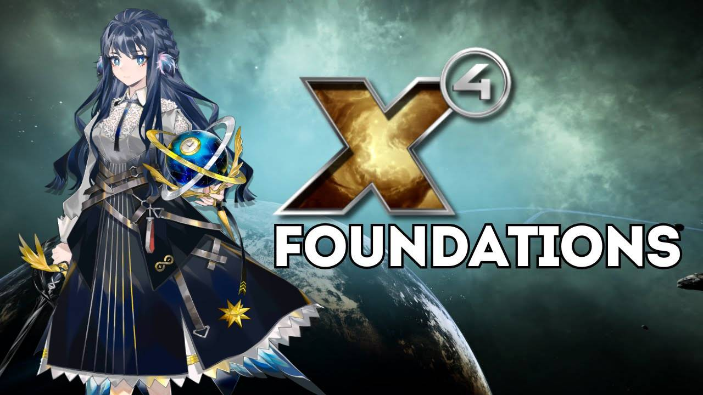

# Apus / 天燕座星穹协约

[English](#english) | [简体中文](#简体中文)

An original story expansion for **X4: Foundations 9.00**, centered on the
**Apus Stellar Treaty (AST)** and the mystery beyond the Artemis gate.

一款围绕**天燕座星穹协约（AST）**与阿尔特弥斯星门之谜展开的
**X4: Foundations 9.00** 原创剧情扩展。

## English

**Apus Stellar Treaty (AST)** is a story-driven expansion that follows the
Twin Stars and a growing threat beyond the Artemis gate. The campaign combines
original missions and voiced story scenes with the AST fleet, new sectors,
ships, weapons, stations, economy integration, and a custom gamestart.

### Features

- A multi-chapter original campaign with fully voiced story scenes.
- A new AST faction, military and civilian fleets, ships, weapons, and stations.
- New sectors and the route beyond the Artemis gate.
- A dedicated Apus gamestart.
- Full text localization in English, Simplified Chinese, German, Russian, and Japanese.
- An optional compatibility patch for **Uncharted Skies**.
- A five-language terminology reference for the Apus setting.

### Requirements

- X4: Foundations **9.00**
- **Hyperion Pack**
- **Cradle of Humanity**
- **Timelines**
- **Envoy Pack**

The compatibility patch additionally requires **Uncharted Skies**.

### Downloads

| Package | Contents | SHA-256 |
| --- | --- | --- |
| [Apus-Version5.99.1.1.zip](https://github.com/starmatch666-droid/Apus/releases/download/v5.99.1.1/Apus-Version5.99.1.1.zip) | Main Apus mod | `3AA563A0AF42A6BA0FCBBDD11347DD95F0CFC329050FCE110E2CE515D7E21DD5` |
| [Apus-UnchartedSkies-Patch.zip](https://github.com/starmatch666-droid/Apus/releases/download/v5.99.1.1/Apus-UnchartedSkies-Patch.zip) | Optional Uncharted Skies compatibility patch | `418322145BAA7E7BBEE1359768658E54796BB68300119AD3ECD7E97F2F5D23E1` |
| [Apus-Terminology-CN-EN-DE-RU-JA.zip](https://github.com/starmatch666-droid/Apus/releases/download/v5.99.1.1/Apus-Terminology-CN-EN-DE-RU-JA.zip) | CN/EN/DE/RU/JA terminology reference | `C9B3D2C6FD01AFECDDF5A229482A20CFA9CBC4F577BCC9A27D08834C55923A89` |

### Installation

1. Close X4: Foundations completely.
2. Extract the `apus` folder from the main archive into:

   `X4 Foundations/extensions/`

   The final path should be `X4 Foundations/extensions/apus/content.xml`.

3. If using Uncharted Skies, extract `Apus_UnchartedSkiesPatch` into the same
   `extensions/` directory.
4. Start the game and enable Apus in the extensions menu if necessary.

The terminology archive is documentation only and does not need to be installed
in the game directory.

### Compatibility Notes

The Uncharted Skies patch moves the Apus sectors one grid cell north to prevent
overlaps with vanilla sectors relocated by Uncharted Skies. It should only be
enabled when both Apus and Uncharted Skies are installed.

## 简体中文

**天燕座星穹协约（AST）**是一款以双子星姐妹与阿尔特弥斯星门背后威胁为主线的
X4: Foundations 剧情扩展。内容包含原创任务与配音剧情、AST 阵营和舰队、新星区、
舰船、武器、空间站、经济整合以及专属游戏开局。

### 主要内容

- 多章节原创主线，剧情场景带有配音。
- 新增 AST 阵营、军用与民用舰队、舰船、武器和空间站。
- 新增星区，以及通往阿尔特弥斯星门另一侧的新航路。
- 独立的 Apus 专属开局。
- 英语、简体中文、德语、俄语、日语全文本本地化。
- 可选的 **Uncharted Skies** 兼容补丁。
- 中、英、德、俄、日五语专有名词对照表。

### 运行要求

- X4: Foundations **9.00**
- **Hyperion Pack**
- **Cradle of Humanity**
- **Timelines**
- **Envoy Pack**

Uncharted Skies 兼容补丁还需要安装 **Uncharted Skies**。

### 下载

| 文件 | 内容 | SHA-256 |
| --- | --- | --- |
| [Apus-Version5.99.1.1.zip](https://github.com/starmatch666-droid/Apus/releases/download/v5.99.1.1/Apus-Version5.99.1.1.zip) | Apus 主模组 | `3AA563A0AF42A6BA0FCBBDD11347DD95F0CFC329050FCE110E2CE515D7E21DD5` |
| [Apus-UnchartedSkies-Patch.zip](https://github.com/starmatch666-droid/Apus/releases/download/v5.99.1.1/Apus-UnchartedSkies-Patch.zip) | 可选的 Uncharted Skies 兼容补丁 | `418322145BAA7E7BBEE1359768658E54796BB68300119AD3ECD7E97F2F5D23E1` |
| [Apus-Terminology-CN-EN-DE-RU-JA.zip](https://github.com/starmatch666-droid/Apus/releases/download/v5.99.1.1/Apus-Terminology-CN-EN-DE-RU-JA.zip) | 中英德俄日术语对照表 | `C9B3D2C6FD01AFECDDF5A229482A20CFA9CBC4F577BCC9A27D08834C55923A89` |

### 安装方法

1. 完全退出 X4: Foundations。
2. 将主压缩包中的 `apus` 文件夹解压到：

   `X4 Foundations/extensions/`

   最终路径应为 `X4 Foundations/extensions/apus/content.xml`。

3. 如果使用 Uncharted Skies，再将 `Apus_UnchartedSkiesPatch` 解压到同一个
   `extensions/` 目录。
4. 启动游戏；如有需要，在扩展菜单中启用 Apus。

术语表压缩包只是参考资料，不需要安装到游戏目录。

### 兼容说明

Uncharted Skies 补丁会将 Apus 星区整体上移一格，避免与 Uncharted Skies
重排后的原版星区重叠。只有同时安装 Apus 与 Uncharted Skies 时才需要启用。

---

Author / 作者: **Cyber1j1e**
